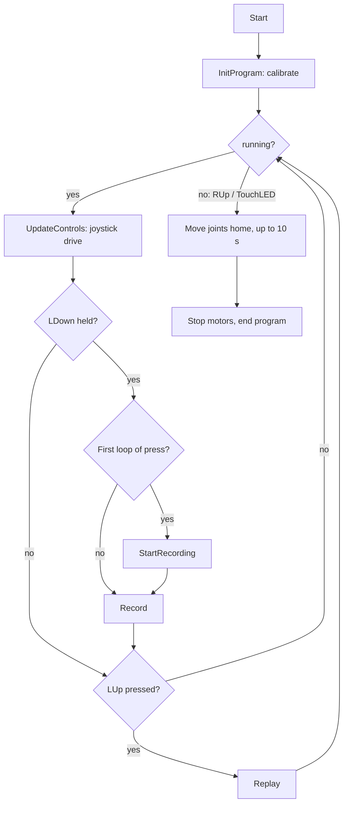

# Record-Replay VEX Robot Arm

A VEX IQ robot arm that you drive by hand, record, and play back.
Hold a button while you move the arm, and the robot repeats the same motion
at the same speed, as many times as you want.

Built as a first-year Mechatronics Engineering design project at the
University of Waterloo.

## Features

- **Manual control**: each joint is driven with a joystick, with drift filtering and joint limits to protect the wiring
- **Record**: hold LDown to sample every joint's position every 50 ms (up to 50 s)
- **Replay**: press LUp to play the recording back smoothly at its original speed, looping until stopped
- **Pickup check**: a distance sensor checks the gripper during replay and stops if an object that was held in the recording is missing
- **Safe shutdown**: RUp or the TouchLED returns every joint to its home position before the program ends
- **Status feedback**: the Brain screen shows the current mode, and the TouchLED changes colour

## Controls

| Input | Action |
|---|---|
| Joystick C | Base joint |
| Joystick D | Shoulder joint (v1) |
| Joystick B | Gripper |
| LDown (hold) | Record |
| LUp | Start replay / stop replay |
| RUp or TouchLED | Shut down (also ends a replay) |

| TouchLED | Mode |
|---|---|
| Blue | Manual |
| Blinking red | Recording |
| Green | Replaying |
| Purple | Shutting down |

## How it works

### Main loop



### Recording

The main loop runs about every 10 ms. `Record()` only saves a sample when the
recording timer has passed `SampleCount × 50 ms`, so each sample is exactly
50 ms apart. A `wasRecording` flag catches the first loop of each LDown press,
so `StartRecording()` resets the data once per press instead of every loop.

### Replay

Samples are 50 ms apart, but replay updates every 10 ms. Each frame, replay
works out where it is between two samples and blends between them:

```
exact    = time / 50          e.g. 170 ms → 3.4
i, j     = 3, 4               the samples on either side
fraction = 0.4                40% of the way from i to j
target   = pos[i] + (pos[j] − pos[i]) × fraction
```

This keeps the motion smooth and at the same speed as the recording.

### Following a target

`FollowPos()` uses proportional control: the motor speed is the error
(target − current angle) multiplied by a gain, so the joint moves fast when
far away and slows down as it arrives.

- Within 2° → hold position (avoids jitter)
- Minimum 8% speed, so the motor always has enough power to move
- Maximum 70% speed, for safety

## Hardware

| Port | Device |
|---|---|
| 1 | Base motor |
| 2 | Shoulder motor (v1) |
| 4 | Gripper motor |
| 5 | Optical sensor |
| 6 | Distance sensor (gripper pickup check) |
| 9 | TouchLED |

### Design history

The first design had a fourth (elbow) motor. With the motor mounted at the end
of the arm, the base joint did not have enough torque to lift it, so the
current, tested version uses three motors.

### Next design (4 motors)

If time allows, the team plans to bring the fourth motor back with a redesign
that cuts the load on the joints:

- **Chain drive**: the motor that sat at the end of the arm moves down to the base and drives its joint through a chain, so its weight no longer hangs off the arm
- **Gear reduction**: the chain gears the joint down for more torque
- **Lighter gripper**: about half the weight of the original
- **Shorter arm**: less leverage working against each joint

## Status

The code in this repository is tested and working on the 3-motor arm.
Upcoming changes:

- Retune the joint limits (`BaseLimit`, `v1Limit`, `gripLimit`)
- If the 4-motor design is built: add the fourth joint back to recording,
  replay, manual control and shutdown, and retune `SNAP`, `TOLERANCE`,
  `DEADBAND` and `HOME_POS` for the geared joint (the encoder measures the
  motor shaft, so a geared joint turns fewer degrees than the motor)

## Possible improvements

- Group each joint's motor, recording and control into a `Joint` class instead of separate arrays
- Show a message on the Brain screen when the pickup check stops a replay

## Team

- Reagan
- Jiyul
- Alex
- Andrew
